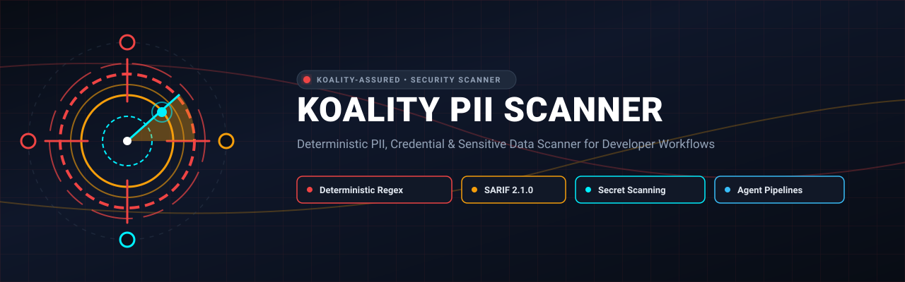

<div align="center">



# Koality PII Scanner

<p align="center">
  
</p>

**Deterministic PII, Credential & Sensitive Data Scanner for Developer Workflows**

[](https://github.com/Koality-Assured/koality-pii-scanner/actions/workflows/ci.yml)
[](LICENSE)
[](pyproject.toml)
[]()
[](https://conventionalcommits.org)

</div>

---

Deterministic PII, credential, and sensitive data scanner designed for developer workflows, automated security gates, and AI agent pipelines. Detects hardcoded secrets, private keys, government IDs, financial identifiers, gaming platform IDs, and personal data patterns in source files, directories, and zip artifacts.
Ships as a **Python package + CLI** (`koality-pii-scan` / `pii-scan`), a **GitHub Action** specification, and an **agent script** (`scripts/agent_scan.py`).

---

## Key Features
- **Deterministic & High-Precision**: Focused on high precision over noisy heuristics. Offline, zero-network-dependency, fast regex engine.
- **Comprehensive Ruleset**:
  - **Credentials**: AWS access keys, GitHub tokens, Slack tokens, JWTs, Stripe/SendGrid/Twilio/Firebase keys, npm/PyPI tokens, PEM private key blocks, bearer tokens, OAuth tokens, and GCP service account keys.
  - **PII**: US SSNs, phone numbers, public webmail addresses, UK National Insurance numbers, dates of birth, US passports, and GDPR Art. 9 special category data (health, biometric, demographic).
  - **Financial**: Credit cards (major networks), IBANs, US bank routing numbers, EINs, and ITINs.
  - **Gaming & Online Identifiers**: Steam IDs (SteamID64, Legacy, ID3), Nintendo Switch friend codes, PSN IDs, Xbox XUIDs, Epic account IDs, Apple Game Center IDs, Discord snowflakes, and advertising identifiers (IDFA, GAID).
- **Flexible Targets**: Scan full directories, single source files, or `.zip` archives (with built-in zip-bomb and path-traversal defenses).
- **Multiple Output Formats**: Human-readable **Table**, structured **JSON**, and standard **SARIF v2.1.0** for GitHub Code Scanning and security dashboards.
- **False-Positive Mitigations**:
  - **Value Allowlist**: Suppresses vendor documentation examples (e.g. AWS canonical test keys, Stripe sample keys) and test credit card numbers.
  - **Context Anchoring**: Distinguishes generic numbers or hex strings by requiring assignment context.
  - **Minified Blob Defense**: Automatically skips minified bundles or generated blobs (>10,000 char lines) to avoid regex backtracking.
- **Suppression Support**: Suppress false positives via inline comments (`# piiscan:ignore`) or a project-root `.piiscan-ignore` file.
---
## Quickstart
### Installation
```bash
# Using pip
pip install .
# Or using uv (recommended for speed)
uv pip install .
```
### Basic Scans
```bash
# Scan a directory
koality-pii-scan detect --source ./src
# Scan a single file
koality-pii-scan detect --source ./config/settings.py
# Scan a zip artifact and write a JSON report
koality-pii-scan detect --source artifact.zip --report-format json --report-path report.json
# Output as SARIF v2.1.0 for GitHub Code Scanning
koality-pii-scan detect --source . --report-format sarif --report-path results.sarif
# Human-readable table output, exit 0 (never fail the build)
koality-pii-scan detect --source . --report-format table --exit-code 0
# Use a custom ruleset
koality-pii-scan detect --source . --rules custom-rules.yaml
```
*(Note: `pii-scan` is also provided as an alias for `koality-pii-scan`)*.
---
## CLI Reference
### `koality-pii-scan detect`
| Option | Default | Description |
|---|---|---|
| `--source PATH` | *(required)* | Path to directory, file, or `.zip` file to scan |
| `--report-format FORMAT` | `json` | Output format: `json`, `table`, or `sarif` |
| `--report-path PATH` | `-` | Output file path. Use `-` for stdout |
| `--redact / --no-redact` | `--redact` | Redact matched sensitive values in output with `[REDACTED]` |
| `--exit-code N` | `1` | Exit code returned when unsuppressed findings are detected. `0` disables failure exit code. |
| `--rules PATH` | `None` | Path to custom rules YAML file. Defaults to embedded ruleset |
### Exit Codes
- `0`: Clean (no unsuppressed findings)
- `1`: Findings detected (when `--exit-code 1`)
- `2`: Scanner error (unreadable path, malformed rule regex, or corrupted archive)
---
## Report Formats
### JSON Output
Each finding is represented as a structured object:
```json
[
  {
    "rule_id": "pii-scan:ssn-us",
    "source": "pii-scan",
    "severity": "critical",
    "category": "pii",
    "cwe": ["CWE-359"],
    "file": "data/users.csv",
    "line": 3,
    "summary": "US Social Security Number detected",
    "remediation": "Remove SSN from source files. Store in a secrets manager or encrypted database.",
    "redacted_match": "[REDACTED]"
  }
]
```
### Table Output
```text
  FILE                                     LINE  SEVERITY    RULE ID
  --------------------------------------------------------------------------------
  data/users.csv                              3  CRITICAL    pii-scan:ssn-us
    US Social Security Number detected
    Match: [REDACTED]
```
### SARIF Output
Produces valid OASIS SARIF v2.1.0 JSON compatible with GitHub Advanced Security code scanning:
```bash
koality-pii-scan detect --source . --report-format sarif --report-path pii.sarif
```
---
## Suppression
Findings can be suppressed without silently dropping them from reports:
### 1. Inline Comments
Add `# piiscan:ignore` or `// piiscan:ignore` to the end of any line:
```python
# Suppress all findings on this line
dummy_ssn = "123-45-6789"  # piiscan:ignore
# Or suppress a specific rule only
test_val = "123-45-6789"  # piiscan:ignore[ssn-us]
```
### 2. `.piiscan-ignore` File
Create a `.piiscan-ignore` file at the root of the scanned project:
```gitignore
# Ignore a rule across the entire project
email-public-service
# Ignore all findings in a directory or file pattern
tests/fixtures/*
*.mock.json
# Ignore a specific rule in a specific path
ssn-us:testdata/dirty/ssn.csv
```
Suppressed findings are marked with `"suppressed": true` in JSON/SARIF and do **not** trigger a non-zero exit code.
---
## Agent and Automation Script
`scripts/agent_scan.py` is a standalone wrapper designed for AI agents, hooks, and external automations. It produces a rich JSON envelope with severity aggregations, category counts, and blocking status:
```bash
python scripts/agent_scan.py --source ./src --format json
```
**Envelope Schema:**
```json
{
  "findings": [...],
  "summary": {
    "total": 1,
    "by_severity": { "critical": 1, "high": 0, "medium": 0, "low": 0, "info": 0 },
    "by_category": { "pii": 1 },
    "blocked_categories": ["pii"]
  },
  "files_scanned": 12,
  "errors": [],
  "exit_code": 1,
  "source": "./src",
  "ruleset_version": "2"
}
```
---
## Python API
You can also use the scanner programmatically in Python applications:
```python
from pathlib import Path
from pii_scan.rules import default_ruleset
from pii_scan.scanner import Config, run
ruleset = default_ruleset()
config = Config(
    source="./src",
    ruleset=ruleset,
    redact=True,
)
result = run(config)
for finding in result.findings:
    if not finding.suppressed:
        print(f"[{finding.severity}] {finding.file}:{finding.line} - {finding.summary}")
```
---
## Development
```bash
# Clone the repository
git clone https://github.com/Koality-Assured/koality-pii-scanner.git
cd koality-pii-scanner
# Install development dependencies
uv pip install -e ".[dev]"
# Run tests
pytest
# Format & Lint
ruff check src/ tests/
ruff format src/ tests/
# Validate fixtures corpus
python scripts/validate_fixtures.py
```
---
## License
This project is licensed under the MIT License — see the [LICENSE](LICENSE) file for details.
